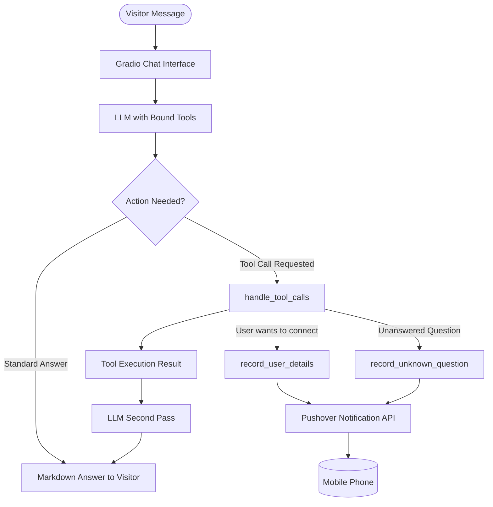

# 🤖 Digital Twin: Agentic AI System

[](https://www.python.org/)
[](https://gradio.app/)
[](https://platform.openai.com/)
[](LICENSE)

An autonomous **AI Digital Twin** designed to represent **Meligi Mohamed** on the web. It interacts with website visitors, recruiters, and clients, answering career questions accurately while using **agentic tool calling** to trigger real-time mobile push notifications for lead capture and telemetry.

---

## 🌟 Key Features

- **🎯 Persona & Grounded Knowledge**:
  - Automatically parses LinkedIn resume data from `linkedin.pdf` via `pypdf`.
  - Ingests personal narrative and career trajectory from `summary.txt`.
  - Built with a strict system prompt preventing hallucinations and staying in character.

- **🛠️ Agentic Tool Calling (Function Calling)**:
  - **`record_user_details`**: Automatically detects when a visitor wants to get in touch, prompts for their email, and captures their contact info.
  - **`record_unknown_question`**: Automatically records questions that the twin cannot answer due to missing context, allowing continuous improvement.

- **📲 Real-time Mobile Push Notifications**:
  - Direct integration with the **Pushover API**.
  - Sends instant notifications to your mobile phone when a recruiter/client leaves their email or when an unknown question is asked.

- **🎨 Tailored UI / UX**:
  - Built with **Gradio `ChatInterface`**.
  - Custom dark/light mode CSS styling (`styles.py`) with branded accents (Gold, Blue, Purple).
  - Client-side auto-focus JavaScript for a seamless chat experience.
  - Curated starter questions for instant visitor engagement.

---

## 📂 Project Architecture

```plaintext
Digital_twin/twin/
├── app.py           # Main application entry point & tool execution loop
├── context.py       # Context loader (PDF parsing, summary ingestion, system prompt)
├── tools.py         # Tool definitions, schemas, and Pushover push notifications
├── styles.py        # Custom CSS, JS autofocus script, and UI theme constants
├── linkedin.pdf     # Source LinkedIn profile / resume
├── summary.txt      # First-person background story and career focus
└── README.md        # Documentation
```

---

## 🚀 Getting Started

### 1. Prerequisites

- Python 3.12+
- Pushover account & mobile app (optional, for notifications)
- API key for OpenAI or Inception Labs

### 2. Installation

Clone the repository and install the dependencies:

```bash
git clone https://github.com/meligi-dev/Twin-Agentic-System.git
cd Twin-Agentic-System
pip install -r requirements.txt
```

*(Or if using [uv](https://github.com/astral-sh/uv): `uv sync`)*

### 3. Environment Configuration

Create a `.env` file in the project root:

```env
# LLM Provider (Inception Labs or OpenAI)
INCEPTION_BASE_URL="https://api.inceptionlabs.ai/v1"
INCEPTION_API_KEY="your_api_key_here"

# Or if using standard OpenAI:
# OPENAI_API_KEY="your_openai_api_key_here"

# Pushover Mobile Notifications
PUSHOVER_USER="your_pushover_user_key"
PUSHOVER_TOKEN="your_pushover_app_token"
```

### 4. Running the Application

Launch the local web server:

```bash
python app.py
```

The app will open automatically in your browser at `http://127.0.0.1:7860`.

To create a shareable 72-hour public link, pass `share=True` in `app.py`:
```python
gr.ChatInterface(...).launch(share=True)
```

---

## 🧠 How the Agent Works



---

## 👤 Author

**Meligi Mohamed**
- Machine Learning & Deep Learning Engineer
- Computer Science Senior, Assiut University
- [LinkedIn Profile](https://www.linkedin.com/in/meligi-mohamed-aa3b412ba)
